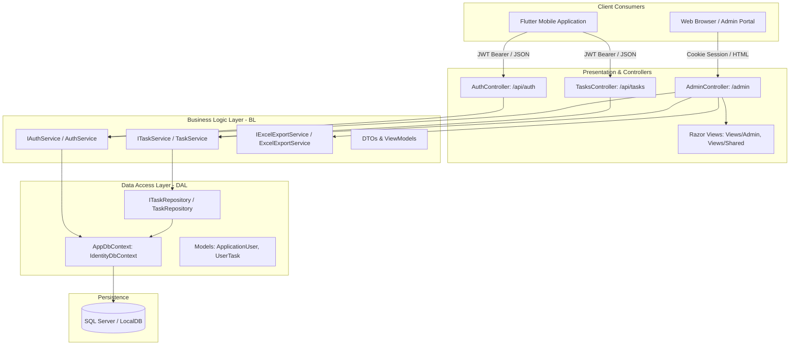

# Task Management System — Software Architecture & Technical Documentation

## 1. System Architecture Overview

The **Task Management System** backend is architected following clean separation of concerns across a 3-tier / N-tier model using **ASP.NET Core 8**, **Entity Framework Core**, **ASP.NET Core Identity**, and **ClosedXML**.

The system satisfies two primary operational roles:
1. **RESTful Web API for Flutter Mobile Clients**: Headless JSON endpoints secured by **JWT Bearer Tokens**.
2. **Web Administrative Dashboard**: Server-side rendered **Razor MVC Views** secured by **Secure HTTP-only Cookies** with dynamic filtering and Excel workbook exportation.



---

## 2. Directory Structure

```
TaskManagementSystem/
├── BL/                                  # Business Logic Layer
│   ├── Common/
│   │   └── DateTimeHelper.cs            # Egypt Standard Time conversion & formatted date utilities
│   ├── DTOs/
│   │   ├── Admin/
│   │   │   ├── AdminDashboardViewModel.cs # ViewModel for admin task listing & filter state
│   │   │   └── AdminLoginViewModel.cs     # ViewModel for admin browser authentication
│   │   ├── Auth/
│   │   │   ├── AuthResponseDto.cs       # Token, roles, expiration, user profile payload
│   │   │   ├── LoginDto.cs              # User login request model
│   │   │   ├── RegisterDto.cs           # User registration request model
│   │   │   └── UserDto.cs               # Lightweight user representation
│   │   └── Tasks/
│   │       ├── CreateTaskDto.cs         # Mobile payload: title, description, taskDate
│   │       ├── TaskFilterDto.cs         # Filtering model (period, dates, userId)
│   │       └── TaskResponseDto.cs       # Serialized task payload with author info
│   └── Services/
│       ├── AuthService.cs               # Identity auth, token generation, user listings
│       ├── IAuthService.cs
│       ├── TaskService.cs               # Task submission, user tasks, admin queries
│       ├── ITaskService.cs
│       ├── ExcelExportService.cs        # ClosedXML spreadsheet generation & styling
│       └── IExcelExportService.cs
├── Controllers/                         # Presentation Layer
│   ├── AdminController.cs               # MVC Controller for Admin Razor Views & Excel Export
│   ├── AuthController.cs                # Web API Controller for Mobile Registration & Login
│   └── TasksController.cs               # Web API Controller for Mobile Task Operations
├── DAL/                                 # Data Access Layer
│   ├── Data/
│   │   ├── AppDbContext.cs              # EF Core context inheriting IdentityDbContext
│   │   └── DbInitializer.cs             # Automatic schema migration & default seed data
│   ├── Models/
│   │   ├── ApplicationUser.cs           # Extended IdentityUser entity
│   │   └── UserTask.cs                  # User task record entity
│   └── Repo/
│       ├── ITaskRepository.cs           # Task repository contract
│       └── TaskRepository.cs            # EF Core query implementation with filters
├── Properties/
│   └── launchSettings.json              # Development port configurations (5153 / 7139)
├── Views/                               # Razor Views for Admin Portal
│   ├── Admin/
│   │   ├── Index.cshtml                 # Admin dashboard with dynamic filters & live refresh
│   │   ├── _TasksTablePartial.cshtml    # Responsive AJAX partial for zero-reload table updates
│   │   └── Login.cshtml                 # Admin portal login view
│   ├── Shared/
│   │   └── _Layout.cshtml               # Bootstrap 5 layout, navbar, branding
│   ├── _ViewImports.cshtml
│   └── _ViewStart.cshtml
├── appsettings.json                     # ConnectionStrings & JwtSettings configuration
├── Program.cs                           # App bootstrapper, DI registration, HTTP pipeline
└── TaskManagementSystem.csproj          # Project file (.NET 8.0, NuGet dependencies)
```

---

## 3. Data Models & Database Schema

### `ApplicationUser` (`AspNetUsers`)
Inherits from `Microsoft.AspNetCore.Identity.IdentityUser`.
- `Id` (string, PK): GUID generated by ASP.NET Core Identity.
- `FullName` (string): Full name of the user.
- `Email` (string): Email address (used as the primary username).
- `PasswordHash` (string): PBKDF2 with HMAC-SHA256 hashed password.
- `CreatedAt` (DateTime): UTC timestamp of account creation.
- `Tasks` (Navigation): `ICollection<UserTask>` — One-to-many relationship with cascade deletion.

### `UserTask` (`Tasks`)
Represents an individual task recorded by an employee/user:
- `Id` (int, PK, Identity): Unique task numeric identifier.
- `Title` (string?, Max 200): Optional brief title.
- `Description` (string, Required, Max 4000): Detailed body of the task.
- `TaskDate` (DateTime, Required): **When the user actually performed/completed the task**. Indexed for fast time-window filtering.
- `CreatedAt` (DateTime, Required): When the task was saved in the backend (`DateTime.UtcNow`).
- `UserId` (string, FK -> `AspNetUsers.Id`): Foreign key referencing the task owner. Indexed for fast user filtering.

### Database Indices
- `IX_Tasks_UserId`: B-tree index on `Tasks(UserId)`.
- `IX_Tasks_TaskDate`: B-tree index on `Tasks(TaskDate)` to guarantee high query throughput when filtering by `period` or date range.

---

## 4. Security Architecture & Dual Authentication

A key architectural design decision was implementing **dual authentication schemes** without code duplication:

| Context | Scheme | Authentication Method | Authorization Attribute |
| :--- | :--- | :--- | :--- |
| **Flutter Mobile Client** | `JwtBearerDefaults.AuthenticationScheme` | `Authorization: Bearer <JWT>` header | `[Authorize]` |
| **Admin Web Portal** | `CookieAuthenticationDefaults.AuthenticationScheme` | Encrypted HTTP-only browser cookie | `[Authorize(AuthenticationSchemes = CookieAuthenticationDefaults.AuthenticationScheme, Roles = "Admin")]` |

### Why this design?
- Standard mobile apps communicate with REST APIs by transmitting bearer tokens in the HTTP `Authorization` header.
- Web browsers submitting GET requests for file downloads (`/admin/export?period=week`) or navigating pages cannot easily inject bearer headers without complex front-end blob handling. Standard cookies allow native browser redirects, clean file download prompts, and session security.

### JWT Claims Structure
- `sub`: User ID
- `nameid`: User ID
- `email`: User email
- `name`: User FullName
- `role`: Roles (e.g. `User`, `Admin`)
- `jti`: Unique token GUID
- `exp`: Expiration timestamp (default: 30 days)

---

## 5. Dependency Injection Map

All dependencies are registered in `Program.cs` using the **Scoped** lifetime (created per HTTP request):

```csharp
// Repositories
builder.Services.AddScoped<ITaskRepository, TaskRepository>();

// Business Services
builder.Services.AddScoped<IAuthService, AuthService>();
builder.Services.AddScoped<ITaskService, TaskService>();
builder.Services.AddScoped<IExcelExportService, ExcelExportService>();
```

---

## 6. Business Logic & Query Filtering Engine

The query engine in `TaskRepository` handles both predefined periods and explicit calendar boundaries:

```csharp
private static IQueryable<UserTask> ApplyFilters(IQueryable<UserTask> query, string? period, DateTime? fromDate, DateTime? toDate)
{
    var now = DateTime.UtcNow;

    if (!string.IsNullOrWhiteSpace(period))
    {
        switch (period.Trim().ToLowerInvariant())
        {
            case "week":
                var weekAgo = now.AddDays(-7);
                query = query.Where(t => t.TaskDate >= weekAgo);
                break;
            case "month":
                var monthAgo = now.AddMonths(-1);
                query = query.Where(t => t.TaskDate >= monthAgo);
                break;
            case "year":
                var yearAgo = now.AddYears(-1);
                query = query.Where(t => t.TaskDate >= yearAgo);
                break;
            case "all":
                break;
        }
    }

    if (fromDate.HasValue)
        query = query.Where(t => t.TaskDate >= fromDate.Value);

    if (toDate.HasValue)
    {
        var inclusiveToDate = toDate.Value.TimeOfDay == TimeSpan.Zero
            ? toDate.Value.Date.AddDays(1).AddTicks(-1)
            : toDate.Value;
        query = query.Where(t => t.TaskDate <= inclusiveToDate);
    }

    return query;
}
```

---

## 7. Excel Export Pipeline (ClosedXML)

The `ExcelExportService` constructs an open XML spreadsheet (`.xlsx`) in memory and streams it to the client:
1. **Title Banner**: Navy blue `#0F2C59` banner with centered bold white text.
2. **Metadata Subtitle (Egypt Local Time)**: Displays active filter parameters along with the exact local Egypt timestamp via `DateTimeHelper.NowInEgypt()` (e.g. `Filters: User: All Users | Period: Last Month | Exported: 2026-10-21 05:50 AM (Egypt Time) | Total: 31`).
3. **Table Headers**: Steel blue `#1F4E79` background with white bold typography.
4. **Data Rows**:
   - Column 1: `Task #` (Numeric, centered)
   - Column 2: `Employee Name` (Text, left-aligned)
   - Column 3: `Email` (Text, left-aligned)
   - Column 4: `When Did They Do It (Task Date)` (Formatted in Egypt Time as `yyyy-MM-dd hh:mm tt`, centered)
   - Column 5: `Submission Date (Created At)` (Formatted in Egypt Time as `yyyy-MM-dd hh:mm tt`, centered)
   - Column 6: `Task Description` (Text wrapped, left-aligned)
5. **Formatting**: Alternating light zebra striping (`#F2F4F7`), thin gray grid borders, and automatic column width adjustments.

---

## 8. API Reference for Mobile (Flutter Client)

### 1. Register User
- **Endpoint**: `POST /api/auth/register`
- **Anonymous**: Yes
- **Request Body**:
```json
{
  "fullName": "Jane Doe",
  "email": "jane@example.com",
  "password": "Password123!"
}
```
- **Response**: `200 OK`
```json
{
  "token": "eyJhbGciOiJIUzI1NiIsInR5cCI6IkpXVCJ9...",
  "email": "jane@example.com",
  "fullName": "Jane Doe",
  "roles": ["User"],
  "expiresAt": "2026-11-20T02:00:00Z"
}
```

### 2. Login User
- **Endpoint**: `POST /api/auth/login`
- **Anonymous**: Yes
- **Request Body**:
```json
{
  "email": "jane@example.com",
  "password": "Password123!"
}
```
- **Response**: `200 OK` (Returns same payload as Register)

### 3. Submit Completed Task
- **Endpoint**: `POST /api/tasks`
- **Authentication**: `Bearer <token>`
- **Request Body**:
```json
{
  "title": "Flutter SQLite Cache",
  "description": "Implemented offline caching for task history using sqflite package.",
  "taskDate": "2026-10-21T08:30:00.000Z"
}
```
- **Response**: `201 Created`
```json
{
  "id": 12,
  "title": "Flutter SQLite Cache",
  "description": "Implemented offline caching for task history using sqflite package.",
  "taskDate": "2026-10-21T08:30:00",
  "createdAt": "2026-10-21T08:32:15.123",
  "userId": "b4737d9e-13c5-430b-b27b-2878bfce31aa",
  "userName": "Jane Doe",
  "userEmail": "jane@example.com"
}
```

### 4. Get My Submitted Tasks
- **Endpoint**: `GET /api/tasks/my-tasks`
- **Authentication**: `Bearer <token>`
- **Query Parameters**:
  - `period`: `week` (last 7 days), `month` (last 30 days), `year` (last 365 days), or `all`
  - `fromDate`: Optional `yyyy-MM-dd` or ISO-8601
  - `toDate`: Optional `yyyy-MM-dd` or ISO-8601
- **Response**: `200 OK`
```json
[
  {
    "id": 12,
    "title": "Flutter SQLite Cache",
    "description": "Implemented offline caching for task history using sqflite package.",
    "taskDate": "2026-10-21T08:30:00",
    "createdAt": "2026-10-21T08:32:15.123",
    "userId": "b4737d9e-13c5-430b-b27b-2878bfce31aa",
    "userName": "Jane Doe",
    "userEmail": "jane@example.com"
  }
]
```

### 5. Edit Task (PUT)
- **Endpoint**: `PUT /api/tasks/{id}`
- **Authentication**: `Bearer <token>`
- **Request Body**:
```json
{
  "title": "Flutter SQLite Cache [UPDATED]",
  "description": "Updated offline sync rules and conflict resolution.",
  "taskDate": "2026-10-21T09:00:00.000Z"
}
```
- **Response**: `200 OK` (Returns updated `TaskResponseDto`).
- **Security Check**: Enforces that regular users can only edit their own tasks. Returns `403 Forbidden` if attempting to edit another user's task. Administrators can edit any task.

---

## 9. Extending the System

1. **Adding New Roles**:
   - Update `DbInitializer.SeedAsync()` to include the role name.
   - Use `[Authorize(Roles = "Manager,Admin")]` on desired endpoints.
2. **Adding New Task Fields**:
   - Add property to `DAL/Models/UserTask.cs`.
   - Update `BL/DTOs/Tasks/CreateTaskDto.cs` and `TaskResponseDto.cs`.
   - Update mappings in `BL/Services/TaskService.cs`.
   - Update `BL/Services/ExcelExportService.cs` to add the column.
   - Run `dotnet tool run dotnet-ef migrations add <MigrationName> --project TaskManagementSystem` and `database update`.
